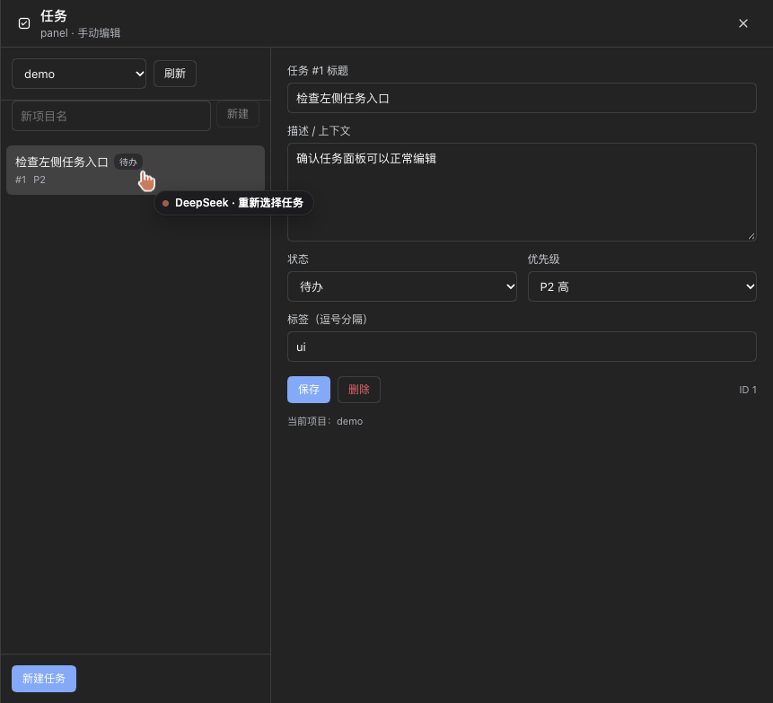

# TAM - Tasks Manager CLI Tool

[](https://crates.io/crates/tam)
[](https://github.com/wst7/tam/blob/main/LICENSE.md)
[](https://github.com/wst7/tam/actions/workflows/release.yml)

A lightweight terminal-based project and task manager.

for the [task-tracker](https://roadmap.sh/projects/task-tracker) challenge from [roadmap.sh](https://roadmap.sh/).


<!--  -->

---

## Features
- 📁 Project Management: Add, edit, and delete projects
- ✅ Task Management: Add, edit, delete tasks and update their status (start, complete)
- 🖥 Dual Mode Support:
	* CLI Mode: Manage with command-line arguments
	* Interactive Mode: Use keyboard-driven terminal UI
- 🎨 Theme Support: Switch between light and dark themes in interactive mode

---

## Installation

### Shell
```bash
curl --proto '=https' --tlsv1.2 -LsSf https://github.com/wst7/tam/releases/download/latest/tam-installer.sh | sh
```

### Powershell
```bash
powershell -ExecutionPolicy Bypass -c "irm https://github.com/wst7/tam/releases/download/latest/tam-installer.ps1 | iex"
```
### Homebrew
```bash
brew install wst7/tap/tam
```
### Npm
```bash
npm install -g @wst7/tam
```
### Crates.io
To install `tam` via [crates.io](https://crates.io/crates/tam):

```bash
cargo install tam
```

### GitHub
To install `tam` from the [GitHub releases](https://github.com/wst7/tam/releases)

---

## Usage

### Command mode
```bash
tam -h
```

```bash
A tasks manager cli tool
Version: 1.0.13

Usage: tam [OPTIONS] [COMMAND]

Commands:
  project  Manage projects, use `tam project --help` to see more options [aliases: p]
  task     Manage tasks, use `tam task --help` to see more options [aliases: t]
  config   Show tam configuration
  help     Print this message or the help of the given subcommand(s)

Options:
  -i, --interactive  Interactive mode
  -h, --help         Print help
  -V, --version      Print version

```

### Interactive mode
```bash
tam -i
```

---

## Agent integration

`tam` can be driven by AI agents through a stable machine contract (schema `tam.agent/v1`): JSON output on stdout, structured errors on stderr, explicit project/agent context, atomic task claims and idempotent creation.

### JSON CLI

```bash
# machine-readable output (global flags may appear before or after the subcommand)
tam status --project tam --json
tam task next --project tam --agent agent-a --claim --lease 900 --json
tam task add "Fix login" --project tam --priority 2 --tag bug --json
tam task list --project tam --status todo --assigned me --json
tam task done 12 --agent agent-a --json
```

Commands: `status`, `project list/current/add`, `task add/list/show/update/claim/heartbeat/release/done/next/events/del`. Every success prints one JSON envelope:

```json
{"ok":true,"schema":"tam.agent/v1","command":"task.claim","data":{"task":{...}},
 "meta":{"project":"tam","agent":"agent-a"}}
```

Failures are printed to stderr with `{ok:false,"error":{"code","message","details"}}`. Exit codes: `0` success, `1` validation/context/internal, `2` CLI usage, `3` not found, `4` conflict (lease/version). Context resolution: `--project` > `TAM_PROJECT` > config `current_project`; `--agent` > `TAM_AGENT`.

#### Multiple projects

If more than one project exists, **do not assume `current_project` is yours** — it is one global config shared by every process. Project-scoped commands (`task list/add`, `status`, `task next`, and their MCP equivalents) need a resolvable project; by-id commands (`task show/update/claim/done/...`) use the global task id unless you pass a project.

```bash
# one agent per project: process-scoped, no global mutation
TAM_PROJECT=tam tam task next --agent agent-a --claim --json

# one agent across projects: pass --project on every project-scoped call,
# and on by-id calls too so cross-project ids become not_found (exit 3)
tam task list --project tam --status todo --json
tam task claim 12 --project tam --agent agent-a --json

# discover projects
tam project list --json
```

For MCP, pass `"project":"<name>"` in every `tools/call`, or launch the server with `"env":{"TAM_PROJECT":"<name>"}` for a single-project agent. `tam project use` is a human convenience; concurrent agents should not rely on it. Without any project context, project-scoped commands fail with `missing_project` (exit 1). Full rules: [docs/agent-protocol.md](docs/agent-protocol.md) §4.3.

Claim semantics: `task claim` is atomic and sets `in-progress` plus a lease (`--lease`, default 900s); concurrent claims yield one success and one `conflict`. `task heartbeat` renews (holder only), `task release` returns the task to `todo`, `task done` clears the lease. `task add --idempotency-key KEY` makes retries return the same task (`deduplicated:true`). All writes append to the `task_events` audit log.

### MCP server

`tam mcp` runs a stdio MCP server (JSON-RPC 2.0, newline delimited) with 12 tools (`tam_status`, `tam_project_list`, `tam_task_list/get/create/update/claim/heartbeat/release/complete/next/events`):

```json
{
  "mcpServers": {
    "tam": { "command": "tam", "args": ["mcp"] }
  }
}
```

The server speaks protocol version `2024-11-05`, keeps stdout free of human output/logs, and reports tool failures via `result.isError=true`. See `docs/agent-protocol.md` for the full contract and `skills/tam-agent/SKILL.md` for an agent-oriented playbook.

### Give this guide to an agent

The single-file brief for an LLM is **[`llms.txt`](llms.txt)**. It is self-contained: project-context rules (including multiple projects), JSON envelope/exit codes, task view, lease/claim loop, all commands, idempotency, MCP setup, and pitfalls. Point the agent at it before it runs `tam` commands.

Four practical ways to deliver it:

1. **MCP (preferred for tool use).** Configure the server; the agent gets the tools directly, while `llms.txt` supplies the usage rules:
   ```json
   { "mcpServers": { "tam": { "command": "tam", "args": ["mcp"] } } }
   ```
   Single-project agents can add `"env":{"TAM_PROJECT":"tam"}`; multi-project agents should pass `"project"` per tool call.

2. **Attach or paste the file into the agent's context.**
   ```bash
   cat llms.txt          # paste into the prompt / attach the file
   ```
   If the client supports file references, use `@llms.txt`. For project-scoped coding agents, add one line to the project instructions (`CLAUDE.md`, `AGENTS.md`, or equivalent):
   ```text
   Before using tam, read llms.txt in this repository.
   ```

3. **Install the packaged skill.** Existing skill installers expose `skills/tam-agent/SKILL.md`:
   ```bash
   npx skills add https://github.com/wst7/tam
   ```

4. **Fetch it by URL** (e.g. for a remote agent or a gist/context loader):
   ```text
   https://raw.githubusercontent.com/wst7/tam/main/llms.txt
   ```

`llms.txt` is maintained alongside `docs/agent-protocol.md`; if the contract changes, update both. The JSON/MCP interfaces are the actual contract; the brief only explains how to use them.

### DSH plugin

This repository ships [`dsh-plugin/`](dsh-plugin/README.md), an installable DeepSeek Harness bundle (`@wst7/dsh-tam`) that exposes 14 native model-facing tools — `tam_status`, `tam_project_list/add`, `tam_task_list/show/create/update/claim/heartbeat/release/complete/next/events/delete`. It wraps the JSON CLI, so the model gets canonical task data without shelling out or parsing tables.

**Install for users** (after the plugin is published to npm):

```bash
dsh plugin --profile desktop add @wst7/dsh-tam
# pin a version
dsh plugin --profile desktop add @wst7/dsh-tam@0.1.0
# restart DeepSeek Harness; the tools appear in the next session
```

Or install a GitHub release tarball, or the local checkout:

```bash
dsh plugin --profile desktop add ./wst7-dsh-tam-0.1.0.tgz
# or, from this repo:
cd /path/to/tam && cargo build
dsh plugin --profile desktop add ./dsh-plugin
```

**tam CLI:** the plugin declares an optional `@wst7/tam` npm dependency, so once tam
1.0.14+ is published, `dsh plugin add @wst7/dsh-tam` also installs the CLI (cargo-dist's
launcher downloads the platform binary on first use). If the optional dependency is
skipped (offline/mirror lag), install tam separately or point `config.command` at it.
Smoke-test it:

```bash
tam --json project list   # must print {"ok":true,"schema":"tam.agent/v1",...}
```

Override the binary/project/agent in the profile's `cordis.patch.yml` if needed:

```yaml
- id: tam-tools
  name: @wst7/dsh-tam
  config:
    command: "/absolute/path/to/tam"
    project: "tam"       # optional default project
    agent: "dsh"         # optional default agent identity
```

The panel is available from the **left sidebar bottom** (`任务` entry): it lists projects
and tasks, and lets you create/edit/delete tasks (title, description, status, priority,
tags) manually. It uses the same database and lease rules as the tools.



Multi-project rule still applies: pass `project` on every project-scoped tool call. Tool reference and development tests: [`dsh-plugin/README.md`](dsh-plugin/README.md). Maintainer release steps (npm / tarball / CI / versioning): [`dsh-plugin/PUBLISHING.md`](dsh-plugin/PUBLISHING.md).

### Database migration

The agent features are additive: on the first run of an old database it is backed up to `tam.db3.bak.v1`, new task columns, `task_events` and indexes are added, and `PRAGMA user_version` becomes `2`. Existing rows are never rewritten (defaults: `priority=3`, `revision=1`, no lease). Schema v2 allows an idempotency key to be reused after the previous task was soft-deleted.

---

## AI Assistant Skill

A usage skill is bundled in this repository to help AI assistants (Claude Code, Codex, OpenCode, Cursor, etc.) provide accurate `tam` command guidance.

### Install via `npx skills` (Recommended)

```bash
# Install from GitHub
npx skills add https://github.com/wst7/tam

```

### What's Included

The `tam-usage` skill covers:

- Installation methods (Shell, PowerShell, Homebrew, npm, cargo)
- Complete CLI command reference with aliases
- Project / Task management workflow
- Data model and soft-delete conventions
- Common pitfalls (e.g., forgetting `tam project use`)
- Troubleshooting tips

Once installed, your assistant will automatically load this skill when you ask questions about managing projects or tasks with `tam`.

---

## Contributing

Contributions are welcome! Please submit an issue or pull request on the [GitHub repository](https://github.com/wst7/tam).

---

## License

`tam` is licensed under the [MIT License](LICENSE).
